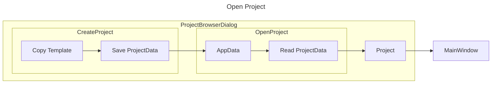

> [!note]+ **Revision History**


![[004 Open-Create Project-1792802995000.png|500x281]]
# 핵심 사항

- XML Serialize/Deserialize
- Toggle Page
- WPF DataContext

# 화면 스크린샷

- Create Project
![[Untitled.png|456]]
- Open Project
![[Untitled 1.png|455]]

# 추가된 내용

1. App시작하면 Project를 생성 또는 Open할 수 있는 `ProjectBrowserDialog` 를 띄우고 Open할 Project 가져오는 기능
![[Untitled 2.png]]
![[Untitled 3.png]]
![[Untitled 4.png]]
2. Project 폴더에는 아래의 정보들이 저장됨
	1. 폴더 구조
```c++
{ProjectPath}\
├── {ProjectName}.primal      ← 프로젝트 + 씬 + 엔티티 + 컴포넌트 (한 파일에 직렬화)
├── {ProjectName}.sln        ← 게임 코드 솔루션
├── .Primal\                 ← 숨김, 메타/임시
│   ├── Icon.png
│   ├── Screenshot.png
│   └── Temp\
├── Content\                 ← 에셋 (메시, 텍스처 등)
│   └── (에셋 파일들)
├── GameCode\                ← C++ 소스 + 프로젝트
│   ├── {ProjectName}.vcxproj
│   └── (Scripts.cpp 등)
└── x64\                     ← 빌드 출력 (Editor에서 빌드 시)
    ├── DebugEditor\
    │   └── {ProjectName}.dll
    └── ReleaseEditor\
        └── {ProjectName}.dll
```
	2. `{ProjectName}.primal` 에 저장되는 내용
		- Scene, 엔티티, 컴포넌트의 구조로 직렬화되어 저장됨.
		- Meta(프로젝트 설정)
| 저장 항목 | 내용 |
| --- | --- |
| **Name** | 프로젝트 이름 |
| **Path** | 프로젝트 루트 폴더 경로 |
| **BuildConfig** | 빌드 설정 (0=Debug, 1=Release 등) |
| **Scenes** | 씬 목록 (배열) |
		- Scene 하나당
| 항목 | 내용 |
| --- | --- |
| **Name** | 씬 이름 |
| **IsActive** | 현재 에디터에서 활성 씬인지 |
| **GameEntities** | 해당 씬에 속한 엔티티 목록 |
		- GameEntity 하나당
| 항목 | 내용 |
| --- | --- |
| **Name** | 엔티티 이름 |
| **IsEnabled** | 활성화 여부 |
| **ParentScene** | 참조(어느 씬 소속인지) |
| **Components** | Transform, Script 등 컴포넌트 목록 |

			- Transform
				- Position, Rotation, Scale(Vector3)
			- Script
				- Name: ex.) `rotator_script` 스크립트 타입 이름만 저장됨. 실제 코드는 GameCode DLL쪽에 있음
				- Entity ID: 런타임에 Engine이 부여함. 저장/로드 시 재생성됨.
				- AvailableScripts: DLL 로드 시마다 GetScriptNmaes()로 다시 채움
				- IsActive: 씬의 IsActive에 맞춰 로드 후 동기화.
	3. `Content(에셋)` 
		- Mesh(.model), 텍스쳐, 머티리얼등 에셋 파일이 저장됨
3. 화면에 버튼으로 Page를 전환하는 기능
	4. Stack Panel 2개 생성해서 margin으로 show/hide조정
	5. 각 Stack Panel에 WPF UserControl로 구현(NewProjectView/ OpenProjectView)
4. Template 파일을 로딩하고 OpenProject시 복사해주는 기능
> [!note]+ Ex. ProjectTemplate
> ![[Icon.png]]
> 
> ![[Screenshot.png]]
> 
> [[Primal/Primal_Attachment/template.xml]]
> 
> [[Primal/Primal_Attachment/project.primal]]

	- template.xml
```xml
<ProjectTemplate
	xmlns="http://schemas.datacontract.org/2004/07/PrimalEditor.GameProject"
	xmlns:i="http://www.w3.org/2001/XMLSchema-instance">
	<Folders
		xmlns:a="http://schemas.microsoft.com/2003/10/Serialization/Arrays">
		<a:string>.Primal</a:string>
		<a:string>Content</a:string>
		<a:string>GameCode</a:string>
	</Folders>
	<ProjectFile>project.primal</ProjectFile>
	<ProjectType>Empty Project</ProjectType>
</ProjectTemplate>
```
	- project.primal
```xml
<Game z:Id="i1"
	xmlns="http://schemas.datacontract.org/2004/07/PrimalEditor.GameProject"
	xmlns:i="http://www.w3.org/2001/XMLSchema-instance"
	xmlns:z="http://schemas.microsoft.com/2003/10/Serialization/">
	<Name>{0}</Name>
	<Path>{1}</Path>
	<Scenes>
		<Scene z:Id="i2">
			<IsActive>true</IsActive>
			<Name>Default Scene</Name>
			<Project z:Ref="i1"/>
		</Scene>
	</Scenes>
</Game>
```
	- XML Serialize/Deserialize
		- DataContract, DataMember
		- IsReference = true로 포인터도  ref id로 serialize 구현 가
5. AppData사용하여 Project 파일 관리하는 기능
	- XML Serialize/Deserialize
		- Project파일 경로와 이름, 최근 수정날짜 저장
```xml
<ProjectDataList
	xmlns="http://schemas.datacontract.org/2004/07/PrimalEditor.GameProject"
	xmlns:i="http://www.w3.org/2001/XMLSchema-instance">
	<Projects>
		<ProjectData>
			<Date>2024-04-28T22:32:04.0848365+09:00</Date>
			<ProjectName>NewProject</ProjectName>
			<ProjectPath>C:\Users\jungt\Documents\PrimalProjects\NewProject\</ProjectPath>
		</ProjectData>
	</Projects>
</ProjectDataList>
```
	- ProjectData을 Deserialize해서 Path를 가져오고, 이를 Project 클래스로 Deserialize해온다.
6. NewProjectView/OpenProjectView에서 Project를 선택하면 `Project` 클래스를 리턴하고, 이를 MainWindow의 DataContext로 연결시킨다.

