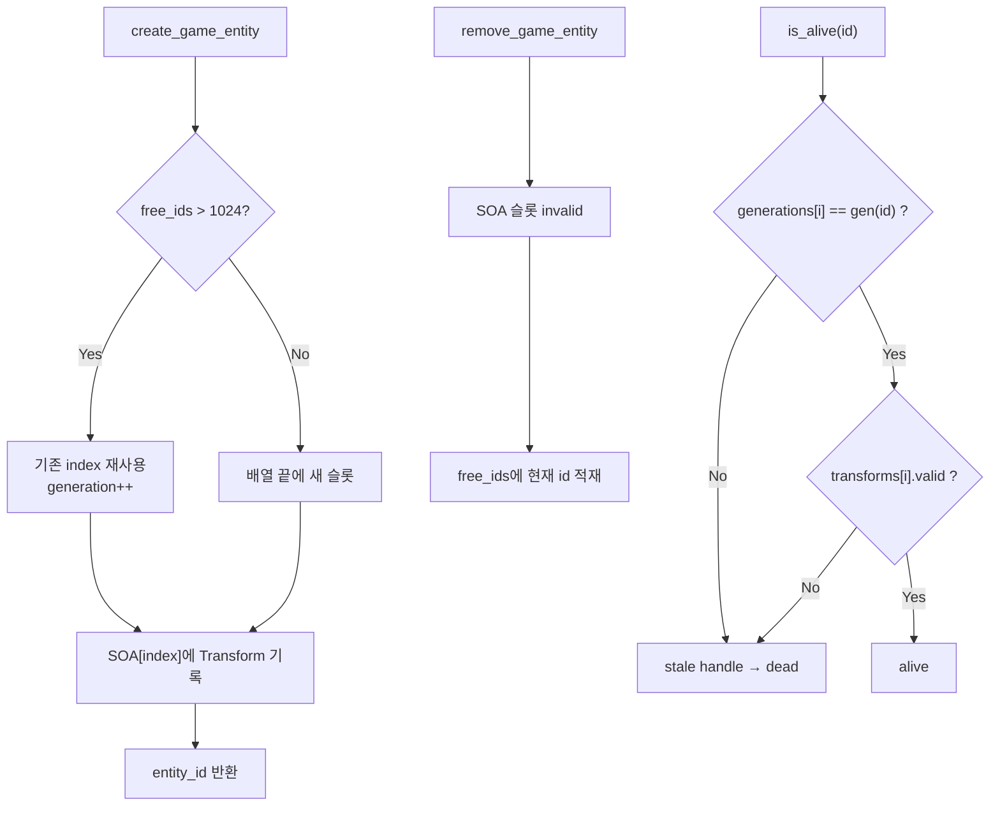

> [!note] 📘
> 이 번 생성분 작업 범위
> 1. DOD(Data Oriented Design)으로 Engine의 Entity·Component 관리 기능 추가
> 2. Engine 코드를 테스트하는 Test 프로젝트 추가
> 3. Engine 코드(static lib)를 C#에서 사용할 수 있도록 DLL로 Export
> 4. WPF에서 엔진 코드를 사용하는 기능 추가

# 1. 설계 배경: 왜 메모리 레이아웃부터 잡는가

- GPU 파이프라인의 성능을 극대화(`CopyBufferRegion`, `Structured Buffer`, `Indirect Draw`)하기 위해서는 CPU → GPU로 전달할 메모리 레이아웃 설계가 매우 중요함.
- 게임 런타임은 매 프레임 같은 종류의 데이터를 수천~수만 개씩 순회함. Transform이면 position/rotation/scale, 이후 Mesh·Script·Light Pass도 마찬가지.
- 따라서 객체보다 **그대로 복사·바인딩할 수 있는 연속 배열 형태**가 유리하고, CPU·GPU 레이아웃을 1:1로 일치시키는 것이 최적화의 기반이 됨.

## 1.1 AoS vs **SoA**

| 관점 | AoS (Array of Structure) | SoA (Structure of Array) |
| --- | --- | --- |
| 구조 | Entity 단위로 Component를 묶어 저장 | Component 타입별 배열로 분리 저장 |
| Stride | Component 조합이 제각각이라 일정하지 않거나 구조체가 거대해짐 | Position(`XMFLOAT3`), Rotation(`XMFLOAT4`), Scale(`XMFLOAT3`) 등 요소당 바이트 크기가 명확하게 고정 |
| 장점 | 개발자에게 매우 직관적 | 캐시 효율·SIMD·GPU 업로드에 유리 |

![[Untitled 55.png]]

![[Untitled 56.png]]

```javascript
Data Oriented Design (DOD) - Engine Side
[SoA - 타입 단위로 묶음, 타입별 배열로 분리 저장]
┌─────────────────────────────────────┐
│ Transforms: [T0][T1][T2][T3]...     │  ← 연속!
├─────────────────────────────────────┤
│ Scripts:    [S0][S1][S2][S3]...     │  ← 연속!
├─────────────────────────────────────┤
│ Meshes:     [M0][M1][M2][M3]...     │  ← 연속!
└─────────────────────────────────────┘
메모리: [T0|T1|T2|T3] [S0|S1|S2|S3] [M0|M1|M2|M3]  ← 타입별 연속

Object Oriented Design (OOD)
[AoS - 객체 단위로 묶어서 저장]
┌─────────────────┐ ┌─────────────────┐ ┌─────────────────┐
│ Entity 0        │ │ Entity 1        │ │ Entity 2        │
│ ├─ Transform    │ │ ├─ Transform    │ │ ├─ Transform    │
│ ├─ Script       │ │ ├─ Script       │ │ ├─ Script       │
│ └─ Mesh         │ │ └─ Mesh         │ │ └─ Mesh         │
└─────────────────┘ └─────────────────┘ └─────────────────┘
메모리: [T0|S0|M0] [T1|S1|M1] [T2|S2|M2]  ← 섞여있음
```

## 1.2 AoS의 한계

- 객체의 Component 구성(position, mesh, material 등)이 제각각이면 GPU에 넘길 데이터 형태도 제각각이 됨.
- Shader가 읽을 Resource binding도 매번 다르게 설정해야 함 → **Root Parameter 개수가 제각각이고 Root Signature 구조도 복잡**해짐.
- DX12에서 Root Signature의 Parameter가 많고 자주 바뀜면 CPU가 레지스터를 다시 설정하는 오버헤드가 큼.
- 즉, OOP식 컴포넌트는 캐시·GPU 업로드 모두에 불리함.

## 1.3 SoA의 이점

- 각 컴포넌트의 요소 크기를 알고 있으니 큰 배열로 메모리를 잡아 **Descriptor Table**화할 수 있음 → 하나의 GPU 레지스터에 Root Parameter로 설정(`Position 버퍼 주소(t0)`, `Rotation 버퍼 주소(t1)`, `Scale 버퍼 주소(t2)`).
- float3/float4 배열은 `D3D12_HEAP_TYPE_UPLOAD` 버퍼에 연속 memcpy 한 번으로 올릴 수 있음.
```c++
// Transfrom.cpp — 컴포넌트별 분리 배열
utl::vector<math::v4> rotations;
utl::vector<math::v3> positions;
utl::vector<math::v3> scales;
```
- AoS(`struct Transform { v3, v4, v3 }`) 대비 캐시 라인 활용이 좋고, 향후 GPU instancing / compute culling 입력으로 바로 사용 가능.
- 캐시 효율
	- Position만 필요한 패스(이동, 컬링 AABB)는 `positions`만 읽음.
	- Rotation만 필요한 패스는 `rotations`만 읽음.
	- AoS(`struct { v3 pos; v4 rot; v3 scale; }`)는 한 필드만 쓸 때도 나머지 필드가 캐시를 오염시킴.
- 단, index 동기화 때문에 개별 수정을 허용하지 않는 것이 정책 → 새로 생성함.

# 2. OOP → DOD 전환

## 2.1 전통적 OOP 모델의 문제

```c++
Entity (객체)
 ├─ Transform*  → heap 객체
 ├─ Mesh*       → heap 객체
 └─ Script*     → heap 객체
```

`entities[i]` → `transform` → `position` 으로 여러 step을 거치면:

- entity마다 component가 다른 heap 주소에 흩어짐 → 순회할 때 cache miss가 entity 수만큼 발생.
- GPU에 올릴 때도 연속 메모리가 아니라 entity마다 조각을 모아야 함 → entity 자체가 “데이터 + 가상함수 + 소유 포인터”가 섞인 무거운 객체가 됨.

## 2.2 DOD의 사고법

> “entity가 무엇을 가지고 있는가”가 아니라, **이 프레임에 어떤 배열을 한 번에 돌릴 것인가**

- Entity를 클래스가 아닌 **인덱스(슬롯)**로 취급함.
```c++
index 0:  pos | rot | scale
index 1:  pos | rot | scale
index 2:  pos | rot | scale
...
```
- 같은 속성끼리 붙어 있으므로
	- CPU 순회가 Cache 친화적.
	- SIMD / 일괄 연산에 유리.
	- GPU Structured Buffer로 한 번에 memcpy 하기 쉬움.
	- entity 생성·삭제가 `new/delete`가 아니라 배열 push / 슬롯 무효화가 됨.
- 캐시미스 최소화: 관련있는 데이터를 물리적으로 가까이 배치.
- 함수와 데이터 분리: 데이터를 독립적으로 처리할 수 있는 작은 단위로 분할 → 다중 코어 접근이 용이.

## 2.3 Entity Component System(ECS) 관점

1. Object가 가지고 있던 데이터와 함수를 Entity, Component, System으로 분리.
2. Entity는 **게임 세계의 “사물”**. 플레이어, NPC, 나무·바위, 카메라, 조명 등 모든 것이 Entity며 고유 **ID**로만 구성됨. 데이터는 들고 있지 않음.
3. Entity-Component 패턴
```c++
Entity = 껍데기 (ID만 가진 핸들)
  ├─ Transform Component (위치, 회전, 크기)
  ├─ Script Component (행동/로직)
  ├─ Mesh Component (모양)
  └─ Light Component (빛)
```
4. 실제 데이터는 Component가 가지고 있으밀, ID는 데이터를 가져오기 위한 **Ticket**.

# 3. ID 설계

## 3.1 왜 ID 설계가 핵심인가

- DOD는 객체를 복제하지 않음. Data는 전역 배열에만 있고, entity는 이에 접근할 ID만 관리함 → **Entity는 데이터가 아닌 핸들!**
- 그러나 슬롯 재사용 버그를 조심해야 함.

> [!warning] ⚠️
> 슬롯 재사용 버그 시나리오 (stale handle / ABA)
> 5. Entity A가 index `7`을 받음.
> 6. A를 삭제. 슬롯 `7`은 비지만 배열에서 빼지 않음 (DOD는 배열을 shrink하지 않고 늘리거나 재사용함).
> 7. Entity B가 슬롯 `7`을 재사용.
> 8. 에디터/시스템이 아직 A의 핸들을 들고 있으면 B의 Transform을 A인 줄 알고 읽게 됨.

## 3.2 ID 레이아웃 (32bit)

```c++
u32 id
┌────────────────────────────┬──────────┐
│        Index (24 bit)      │ Gen (8)  │
└────────────────────────────┴──────────┘
index(id)      = id & 0x00FFFFFF
generation(id) = (id >> 24) & 0xFF
new_generation = index(id) | ((generation(id) + 1) << 24)
invalid_id     = 0xFFFFFFFF
```

- **Index (24bit)**: 배열 위치. 실제 데이터 접근 키. 약 1,677만 슬롯까지 사용 가능(0 ~ 16,777,215). (255^3)
- **Generation (8bit)**: 이 슬롯이 몇 번째 생명인지. stale handle 검출 키. 슬롯당 255회 재사용까지 구분 가능(0~255).
- **free_ids**: 삭제된 인덱스를 바로 쓰지 않고 모아 두었다가 재사용.
- **is_alive()**: `id.generation == generations[index]` 이고 Transform 슬롯이 valid할 때만 생존.

```javascript
/* ID구조(32비트, 4byte)
┌────────────────────────────────────────┐
│          ID (32비트)                    │
├──────────┬─────────────────────────────┤
│ Generation│         Index              │
│  (8비트)  │        (24비트)             │
├──────────┼─────────────────────────────┤
│  0~255   │      0 ~ 16,777,215         │
└──────────┴─────────────────────────────┘
예: ID = 0x03000001
    → Generation = 3 (이 슬롯이 3번째 재사용됨)
    → Index = 1 (배열의 1번 위치)
Generation: 배열의 해당 슬롯이 몇번 재사용되었는지를 저장.
같은 index라도 Generation이 다르면, 엄연히 다른 개체임(ABA문제 방지)
 (A→B 변경을 감지 못하고 "여전히 A"라고 착각)
*/
```

![[image.png]]

## 3.3 Bitmask

- id를 쪼개어 1byte(generation 확인) + 3byte(index 확인)로 사용함.
- 각 부분을 확인할 수 있는 마스킹 method를 제공.

![[Untitled 57.png]]

- ID로부터 index와 generation을 확인할 수 있는 메소드도 제공.

![[Untitled 58.png]]

![[Untitled 59.png]]

## 3.4 std::conditional로 타입 결정

- `generation_bits`의 크기에 따라 `generation_type`의 type을 결정할 수 있음.

![[Untitled 60.png]]

![[Untitled 61.png]]

# 4. Entity·Component 관리 구조

## 4.1 함수와 데이터 분리

- Data가 Object와 분리되어 있음. Object는 id만 가지고, Data를 가지고오는 함수는 전역 함수로 정의되어 id로만 query 가능.
- 특정 컴포넌트(Transform, Script 등)의 상태를 중앙 집중식으로 관리하는 **Component Manager** 형태. 익명 namespace로 실질적인 데이터를 외부로부터 완전히 격리하고, 허용된 API를 통해서만 조작하게 하는 정적 모듈 패턴.

```c++
// Entity.cpp - 실제 Component들은 여기!
namespace {
    utl::vector<transform::component> transforms;  // Transform 배열
    utl::vector<script::component> scripts;        // Script 배열
    utl::vector<id::generation_type> generations;  // Generation 배열
    utl::deque<entity_id> free_ids;                // 재사용 ID
}
```

![[image 1.png]]

![[image 2.png]]

## 4.2 불변 조건: Transform ID == Entity ID

> [!note] 📌
> 모든 entity는 Transform을 하나씩 가진다.

```c++
// Entity.cpp
vector<transform::component> transforms;
vector<id::generation_type>  generations;
deque<entity_id>             free_ids;

// Transfrom.cpp  (SOA)
vector<math::v4> rotations;
vector<math::v3> positions;
vector<math::v3> scales;
```

- `Transform ID == Entity ID`
- entity를 만들면 Transform 슬롯이 생기고, 지우면 같은 index의 Transform이 무효화됨.
- Transform: `positions`, `rotations`, `scales`를 각각 별도 `utl::vector`에 저장.
- Entity: `transforms` pool과 `generations` 배열로 상태 관리.
- Component ID는 Entity ID와 동일한 index를 사용.

```c++
math::v3 component::position() const
{
    assert( is_valid() );
    return positions[ id::index( _id ) ];
}
```

## 4.3 Entity → Component 조회 경로

9. Entity ID로부터 index를 추출해 Entity.cpp의 SoA(`transform::component`)를 가져옴.
10. Transform component로부터 Transform.cpp의 SoA(`math::v4 rotation` 등)를 가져옴. → component 자체도 id만 가지고 있고, 실제 데이터는 Transform.cpp에 SoA로 격리됨.

```c++
// entity.transform() 호출 시
transform::component entity::transform() const
{
    assert( is_alive( _id ) );           // 1. 유효성 검사 (generation 확인)
    const auto index = id::index( _id ); // 2. ID에서 index 추출
    return transforms[ index ];          // 3. SoA 배열에서 반환
}
```

```c++
Entity ID: 0x00000005 (gen=0, idx=5)

┌─────────────────────────────────────┐
│  generations[]                      │
│  [0][1][0][2][1][0][3]...           │ 
│                  ↑                  │
│               idx=5, gen=0          │
└─────────────────────────────────────┘

┌─────────────────────────────────────┐
│  transforms[]                       │
│  [T0][T1][T2][T3][T4][T5][T6]...    │
│                        ↑            │
│                     idx=5           │
│     position: (1, 2, 3)             │
│     rotation: (0, 0, 0, 1)          │
│     scale: (1, 1, 1)                │
└─────────────────────────────────────┘

┌─────────────────────────────────────┐
│  scripts[]                          │
│  [S0][S1][--][S3][--][S5][S6]...    │
│                       ↑             │
│                    idx=5            │
│     (optional)                      │
└─────────────────────────────────────┘
```

![[image 3.png]]

![[image 4.png]]

![[image 5.png]]

# 5. Entity 생명주기

## 5.1 전체 개요



## 5.2 생성 (create_game_entity)

```c++
free_ids.size() > 1024 ?
    YES → 큐에서 ID를 꺼냄
          index는 유지, generation만 +1
          generations[index]++
    NO  → generations.size()를 새 index로 사용
          generations.push_back(0)
          transforms.emplace_back()
          Transform SOA도 같은 index까지 확장
```

- entity 생성 전 free_ids를 먼저 확인. 충분한 양(1024)이 있으면 재사용하고 generations 값만 +1.
- 충분하지 않으면 배열을 하나 늘림.
	- 새 entity는 `generations.size()`를 index로 사용.
	- entity가 추가되었으니 transform 배열도 하나 늘림.

### Editor(C#) → Engine 생성 경로

```c++
[C# Editor에서]
GameEntity entity 생성
   ├─ Transform { position, rotation, scale }
   └─ Script { name }
        ↓
   IsActive = true 설정
        ↓
[EngineAPI.EntityAPI.CreateGameEntity(entity)]
   ├─ GameEntityDescriptor 생성
   └─ P/Invoke
        ↓
[EntityAPI.cpp::CreateGameEntity()]
   ├─ Descriptor → init_info 변환
   └─ game_entity::create(entity_info)
        ↓
[Entity.cpp::create()]
   ├─ ID 생성 (새로 or 재활용)
   ├─ transforms[idx] = transform::create(...)
   ├─ scripts[idx] = script::create(...) (optional)
   └─ return entity(id)
```

11. C#에서 Add Game Entity 버튼을 클릭하면 C# side에서 GameEntity를 생성.
![[image 6.png]]
12. 초기 `IsActive`가 true가 되면 `CreateGameEntity`가 호출됨. C#은 Engine이 요구하는 Descriptor를 채우고 P/Invoke로 C++ 엔진 코드를 실행 → 반환값으로 EntityID를 받아옴.
![[image 7.png]]
13. Descriptor를 확인하여 Engine Side 메모리에도 component별 SoA를 초기화함.
![[image 8.png]]

## 5.3 생존 판정 (is_alive)

```c++
// Entity.cpp
bool is_alive(entity_id id) {
    const auto index = id::index(id);
    
    return (generations[index] == id::generation(id))  // generation 일치?
           && transforms[index].is_valid();            // transform valid?
}
```

- entity id의 generation과 `generations[entity index]` 값이 동일해야 함.
- transform이 valid해야 함.
- **둘 다 만족해야 함.** generation만 보면 Transform이 실패했거나 비어 있는 슬롯을 놓치고, Transform valid만 보면 이전 generation 핸들이 새 entity를 통과함.

## 5.4 사용 (Script)

> 추후 다른 문서에서 상세하게 다룸.

```c++
// Script.cpp
class player_controller : public script::entity_script {
public:
    void update(float dt) override {
        // ✅ 읽기
        auto pos = position();      // entity._id → transforms[idx].position
        auto rot = rotation();
        
        // ✅ 수정
        pos.x += speed * dt;
        set_position(pos);
    }
};

// GameEntity.h
math::v3 entity::position() const {
    return transform().position();  // transform component 가져오기
}

// Entity.cpp
transform::component entity::transform() const {
    assert(is_alive(_id));
    const auto index = id::index(_id);   // index 추출
    return transforms[index];            // SoA 배열 접근
}
```

## 5.5 삭제 (remove_game_entity)

```c++
is_alive 확인
transform 슬롯 invalid
free_ids.push_back(id)   // 배열에서 erase하지 않음
```

> [!tip] 💡
> DOD는 배열을 erase(중간삭제)하지 않고 invalid 처리만 함. 중간 원소를 빼면 index가 모든 밀리면서 index 기반의 모든 핸들이 깨지기 때문.

```c++
[C# Editor에서]
IsActive = false 설정
        ↓
[EngineAPI.EntityAPI.RemoveGameEntity(entity)]
        ↓
[EntityAPI.cpp::RemoveGameEntity(id)]
        ↓
[Entity.cpp::remove(id)]
   ├─ scripts[idx].remove() (if valid)
   ├─ transforms[idx].remove()
   ├─ transforms[idx] = {} (invalid로 설정)
   ├─ scripts[idx] = {}
   └─ free_ids.push_back(id) (재활용 대기)
```

```c++
// Entity.cpp
void remove(entity_id id) {
    const auto index = id::index(id);
    
    // 1. Script 제거 (optional)
    if (scripts[index].is_valid()) {
        script::remove(scripts[index]);
        scripts[index] = {};
    }
    
    // 2. Transform 제거 (필수)
    transform::remove(transforms[index]);
    transforms[index] = {}; // invalid하게 밀어줌
    
    // 3. 재활용 대기열에 추가
    free_ids.push_back(id); // 재활용
}
```

# 6. Editor(C#) ↔ Engine(C++) 연동

## 6.1 DLL Export 구조

- Engine Lib이 static library로 되어 있어 C#에서 사용하려면 DLL로 만들어야 함.
- Engine.lib을 그대로 노출하지 않고, **EngineDLL.dll이라는 얇은 레이어**를 두고 그 DLL만 C#에서 로드함.

```c++
┌─────────────────────────────────────────────────────────────────┐
│  Primal 솔루션                                                   │
│                                                                 │
│  ┌─────────────────────────────────────────────────────────┐    │
│  │  Engine (Static Library, .lib)                          │    │
│  │  - Entity, Transform, Script, Renderer, Platform 등     │    │
│  │  - 게임/엔진 로직 전부 여기 있음                            │    │
│  │  - “기본” 빌드 형태                                       │    │
│  └─────────────────────────────────────────────────────────┘    │
│                              │                                  │
│                              │ 링크 (코드가 DLL 안에 포함)         │
│                              ▼                                  │
│  ┌─────────────────────────────────────────────────────────┐    │
│  │  EngineDLL (Dynamic Library, .dll)                      │    │
│  │  - Engine을 링크해서 사용                                 │    │
│  │  - C#에서 부를 수 있는 “C 스타일 export 함수”만 제공         │    │
│  │  - “C#에서 쓰기 위해 만든 DLL”                             │    │
│  └─────────────────────────────────────────────────────────┘    │
│                              │                                  │
│                              │ P/Invoke (LoadLibrary + GetProcAddress)
│                              ▼                                  │
│  ┌─────────────────────────────────────────────────────────┐    │
│  │  PrimalEditor (C#, .NET)                                │    │
│  │  - EngineAPI.cs → DllImport("EngineDll.dll")            │    │
│  └─────────────────────────────────────────────────────────┘    │
└─────────────────────────────────────────────────────────────────┘
```

![[image 9.png]]

![[image 10.png]]

### Export 키워드

![[Untitled 62.png]]

- `extern “C”`: C++ 이름 맹글링(컴파일러가 함수 이름을 내부용 기호(symbol)로 바꾸는 것)을 제거 → P/Invoke가 dll을 열어 문자열 이름으로 함수를 찾을 수 있게 됨.
	- C++: 컴파일러가 `?CreateGameEntity@@YAHPEAUgame_entity_descriptor@@@Z` 형식으로 내부 이름을 정함.
	- C: 맹글링하지 않고 `CreateGameEntity` 그대로 사용.
	- 즉 “이 함수는 **C 방식으로 링크해라**, 이름 맹글링 하지 말고 C처럼 이름 그대로 쓰라”는 뜻.
- `__declspec(dllexport)`: 이 함수를 현재 프로젝트(EngineDLL)의 DLL Export 테이블에 넣으라는 지시. 빌드 결과물이 DLL일 때만 의미 있음.
- `#ifndef EDITOR_INTERFACE`: 다른 곳에서 이미 EDITOR_INTERFACE를 정의해 두었으면 그것을 쓰고, 없을 때만 위 정의를 쓰기 위함. (나중에 import 쪽에서 재정의할 때 사용)

## 6.2 P/Invoke

- P/Invoke ⇒ **Platform Invocation Services**. C#에서 C/C++ DLL 함수를 호출하기 위한 .NET 브릿지.
- P/Invoke가 중간에서 DLL 로드 + 함수 주소 찾기 + 인자/반환값 넘기기를 처리.
- `[DllImport(”EngineDll.dll”)]`를 사용하면 P/Invoke가 EngineDll.dll의 export 테이블을 뒤지서 같은 이름의 함수를 찾아 호출함. C#에는 구현이 없으며 실제 구현은 DLL에서 export된 C 함수.

```c++
[C# 코드]
   EngineAPI.LoadGameCodeDll("C:\...\GameCode.dll");
        │
        │  P/Invoke가 하는 일:
        │  1. EngineDll.dll 로드 (LoadLibrary)
        │  2. "LoadGameCodeDll" 이름으로 함수 주소 조회 (GetProcAddress)
        │  3. 인자 마샬링 (string → const char*)
        │  4. 네이티브 함수 호출
        │  5. 반환값을 C# int로 마샬링
        ▼
[C++ DLL]
   __declspec(dllexport) u32 LoadGameCodeDll(const char* dll_path)
   { ... }
```

![[image 11.png]]

![[image 12.png]]

## 6.3 마샬링(Marshaling)

서로 다른 환경(C# ↔ C++) 간에 인자/반환값을 맞춰서 넘기는 것.

| C# 쪽 | C++ 쪽 | P/Invoke가 하는 일 |
| --- | --- | --- |
| string | const char* | UTF-8 등으로 변환해 포인터 전달 |
| int | u32 / int | 그대로 4바이트로 전달 |
| IntPtr | HWND / void* | 포인터 그대로 전달 |
| GameEntityDescriptor (구조체) | game_entity_descriptor* | 메모리 레이아웃 맞춰 복사 |

### 구조체 Interop 원칙 (CreateGameEntity / RemoveGameEntity)

- C#과 Interop하기 위해 C#과 동일한 memory layout을 가지는 클래스(구조체)를 정의해야 함.
- 메모리가 연속적으로 잡힐 수 있도록 C#에서는 구조체 선언 시 `LayoutKind.Sequential`로 설정.
- 기본 type(int, float, byte) array 형식이면 바로 memory 접근해 memcpy 가능.

![[Untitled 63.png]]

![[Untitled 64.png]]

## 6.4 WPF에서 엔진 코드 사용

### 노출 최소화

- DataContract로 된 C# class는 `LayoutKind.Sequential` 설정이 안 될 뿐만 아니라, Engine과 다르게 관리를 위한 데이터 멤버들(IsEnabled, Name 등)이 더 있을 수 있음.
- 중복될 수 있지만 Engine과 통신을 위한 구조체를 별도로 구현함.

![[Untitled 65.png]]

- `GameEntity`를 인자로 받되, Engine에 호환되는 변수로 한번 더 바꿔주는 과정을 거친 후에 호출함.

![[Untitled 66.png]]

### euler → quaternion

- C#에서는 사용자가 보기 좋게 Euler 좌표계로 관리하지만, C++에서는 각도를 Quaternion으로 관리함.
- Euler 값을 받아 Quaternion으로 바꿔주는 기능이 필요.

![[Untitled 67.png]]

# 7. 전체 흐름도

```c++
┌────────────────────────────────────────────────────────────────┐
│  Editor (C#)                                                   │
│  ┌──────────────────────────────────────────────────────────┐  │
│  │  GameEntity entity = new GameEntity();                   │  │
│  │  entity.AddComponent<Transform>();                       │  │
│  │  entity.AddComponent<Script>("player_controller");       │  │
│  │  entity.IsActive = true;  ← 생성 트리거                   │  │
│  └──────────────────────────────────────────────────────────┘  │
└────────────────────────────────────────────────────────────────┘
                              │
                              │ P/Invoke
                              ▼
┌────────────────────────────────────────────────────────────────┐
│  EngineDLL (C++ Bridge)                                        │
│  ┌──────────────────────────────────────────────────────────┐  │
│  │  EntityAPI.cpp::CreateGameEntity(desc)                   │  │
│  │  └─ game_entity::create(entity_info)                     │  │
│  └──────────────────────────────────────────────────────────┘  │
└────────────────────────────────────────────────────────────────┘
                              │
                              ▼
┌────────────────────────────────────────────────────────────────┐
│  Engine Core (C++ Internal)                                    │
│  ┌──────────────────────────────────────────────────────────┐  │
│  │  Entity.cpp::create()                                    │  │
│  │  ├─ ID 할당 (재활용 or 새로)                              │  │
│  │  ├─ transforms[idx] = transform::create(...)             │  │
│  │  ├─ scripts[idx] = script::create(...)                   │  │
│  │  └─ return entity(id)                                    │  │
│  └──────────────────────────────────────────────────────────┘  │
│                              │                                 │
│                              ▼                                 │
│  ┌──────────────────────────────────────────────────────────┐  │
│  │  SoA Arrays                                              │  │
│  │  generations: [0][1][0][2]...                            │  │
│  │  transforms:  [T0][T1][T2][T3]...                        │  │
│  │  scripts:     [S0][S1][--][S3]...                        │  │
│  └──────────────────────────────────────────────────────────┘  │
└────────────────────────────────────────────────────────────────┘
                              │
                              │ 런타임 사용
                              ▼
┌────────────────────────────────────────────────────────────────┐
│  GameCode (User Script)                                        │
│  ┌──────────────────────────────────────────────────────────┐  │
│  │  class player_controller : entity_script {               │  │
│  │      void update(float dt) {                             │  │
│  │          auto pos = position();  ← ID로 조회             │  │
│  │          pos.x += speed * dt;                            │  │
│  │          set_position(pos);                              │  │
│  │      }                                                   │  │
│  │  };                                                      │  │
│  └──────────────────────────────────────────────────────────┘  │
└────────────────────────────────────────────────────────────────┘
```

# 8. 남은 작업

- 화면 스크린샷 정리
- Script 관련 상세 내용은 추후 다른 문서에서 다룸

---

[[[백업] 009-011 원본 내용 (2026-09-26)]]