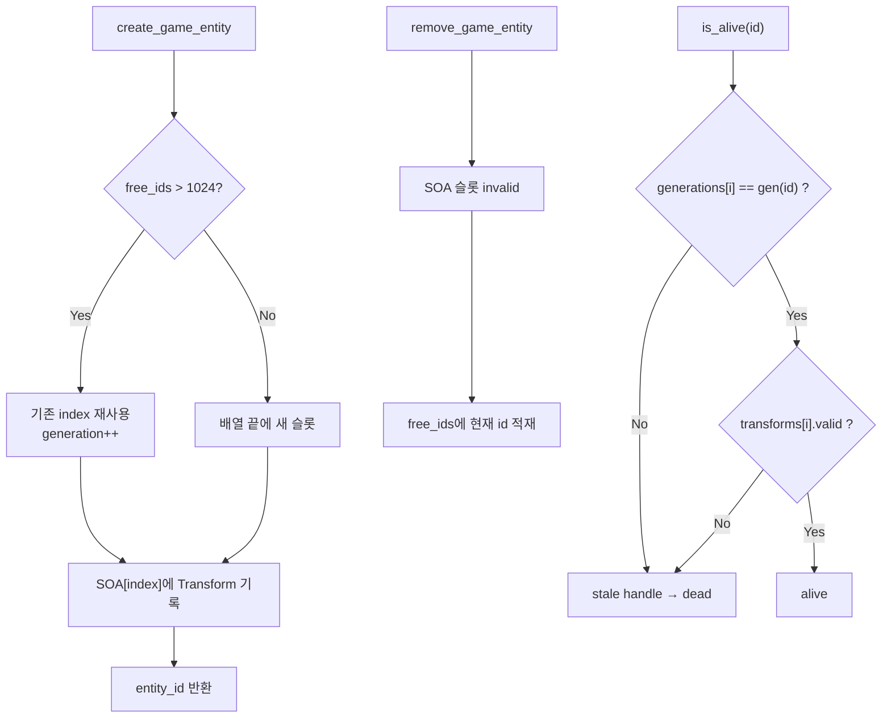

> [!note] 🗄️
> 문서 재정리 이전 원본 내용 백업 (2026-09-26)

# 핵심 사항

1. GPU 파이프라인의 극대화된 성능(`CopyBufferRegion`, `Structured Buffer`, `Indirect Draw`)을 끌어내기 위해서는 CPU → GPU로 전달할 메모리 레이아웃 설계가 매우 중요함.
2. SoA(Structure of Array) vs AoS(Array of Structure)
	- AoS는 Entity별로 Component 조합(Transform, Geometry, Script,..)이 매우 다양해서 크기가 일정하지 않거나 구조체의 크기가 거대해지기 쉽다. (허나 개발자에게 매우 직관적!)
![[Untitled 68.png]]
	- SoA(Structure of Array)는 Entity와 Component 별로 배열로 관리함.  Position(`XMFLOAT3`), Rotation(`XMFLOAT4`), Scale(`XMFLOAT3`) 등 **각 컴포넌트별 배열의 Stride(요소당 바이트 크기)를 명확히 고정시킬 수 있음. **
![[Untitled 69.png]]
3. AoS(Array of Structure) 단점
	- 객체의 Component 구성(position, mesh, material 등)이 제각각이면, GPU에 넘겨야 할 데이터 형태도 제각각임.
	- Shader에서 읽어야할 Resource의 binding도 매번 다르게 설정해야함 → **Root Parameter 개수가 제각각이고, Root Signature 구조도 복잡**해짐.
	- DX12에서는 Root Signature의 Parameter가 많고 자주 바뀌면 CPU가 레지스터를 다시 설정하느라 엄청난 오버헤드가 생김.
	- 즉, OOP식의 컴포넌트는 캐시, GPU 업로드에 불리함.
4. SoA(Structure of Array) 장점
	- 각 컴포넌트(Position, Rotation, Scale, ..)의 요소당 크기를 알고 있으므로, 큰 배열로 메모리를 잡아놓고 **Descriptor Table**화 시킬 수 있음. → 하나의 GPU 레지스터에 Root Parameter로 설정해놓을 수 있음.(`Position 버퍼 주소(t0)`, `Rotation 버퍼 주소(t1)`, `Scale 버퍼 주소(t2)` )
	- float3, float4 의 배열은 `D3D12_HEAP_TYPE_UPLOAD` 버퍼에 연속 memcpy 한 번으로 올릴 수 있음
```c++
// Transfrom.cpp — 컴포넌트별 분리 배열
utl::vector<math::v4> rotations;
utl::vector<math::v3> positions;
utl::vector<math::v3> scales;
```
		- AoS(`struct Transform { v3, v4, v3 }`) 대비 캐시 라인 활용이 좋고, 향후 GPU instancing / compute culling 입력으로 바로 쓰기 쉽다.
	- AoS는 다양한 크기의 컴포넌트 데이터가 하나로 뭉쳐 있어 **크기가 일정하지 않거나 구조체 크기가 거대**해지기 쉽지만, SoA는 위치(`XMFLOAT3`), 회전(`XMFLOAT4`), 크기(`XMFLOAT3`) 등 **각 컴포넌트별 배열의 Stride(요소당 바이트 크기)를 명확히 고정**시킴
	- 캐시 효율
		- Position만 필요한 패스(이동, 컬링 AABB)는 `positions`만 읽으면 됨.
		- Rotation만 필요한 패스는 `rotations`만 읽음.
		- AoS(`struct { v3 pos; v4 rot; v3 scale; }`)면 한 필드만 쓸 때도 나머지 필드가 캐시를 오염시키는 문제가 있음.
5. **DOD(Data Oriented Design)으로 Entity와 Component를 관리함.**
	- 게임 런타임은 매 프레임 같은 종류의 데이터를 수천~수만 개씩 순회함. Transform이면 position/rotation/scale 정보를 알아야 하고, 이후 Mesh·Script·Light Pass 도 마찬가지임.
	- 전통적인 OOP 모델은 대략 다음과 같음
```c++
Entity (객체)
 ├─ Transform*  → heap 객체
 ├─ Mesh*       → heap 객체
 └─ Script*     → heap 객체
```
	- position정보를 얻기 위해서 `entites[i]`-> `transform` -> `position` 으로 여러 step으로 접근하게되면, 아래와 같은 문제가 있음.
		- entity마다 component가 다른 heap 주소에 흩어져 있음. → 순회할 때 cache miss가 entites 수만큼 발생함.
		- GPU에 올릴 때도 연속 메모리가 아니라, entity마다 조각을 모아야 함 → entites 자체도 “데이터 + 가상함수 + 소유 포인터”가 섞인 무거운 객체가 됨.
	- DOD는 조금 다르게 접근함.
> “entity가 무엇을 가지고 있는가”가 아니라, **이 프레임에 어떤 배열을 한 번에 돌릴것인가**

		- Entity를 클래스가 아닌, **인덱스(슬롯) 으로 **취급함
```c++
index 0:  pos | rot | scale
index 1:  pos | rot | scale
index 2:  pos | rot | scale
...
```
		- 같은 속성끼리 붙어 있으므로
			- CPU 순회가 Cache 친화적임.
			- SIMD / 일괄 연산에 유리함.
			- GPU Structured Buffer로 한번에 memcpy 하기 쉬움
			- entites 생성·삭제가 `new/delete`가 아니라 배열 push / 슬롯 무효화가 된다
6. **DOD는 ID관리가 생명!!**
	- DOD는 객체를 복제하지 않음. Data는 전역배열에만 있고, entities안에는 이에 접근할 수 있는 ID만 관리함. → **Entity는 데이터가 아닌 핸들!**
	- 이 때문에 슬롯 재사용되는 버그를 조심해야 함.
		1. Entity A가 index `7`을 받음.
		2. A를 삭제한다. 슬롯 `7`은 비지만 배열에서 빼지 않음 *(DOD는 배열을 shrink하지 않고, 늘리거나 재사용함)*
		3. Entity B가 슬롯 `7`을 재사용함.
		4. **[문제] **에디터/시스템이 아직 A의 핸들을 들고 있으면, B의 Transform을 A인 줄 알고 읽게 됨..
	- 그래서 ID는 식별자일 뿐아니라 슬롯 재사용을 안전하게 사용하기 위한 설계가 함께 고려됨.
```c++
u32 id
┌────────────────────────────┬──────────┐
│        Index (24 bit)      │ Gen (8)  │
└────────────────────────────┴──────────┘
index(id)      = id & 0x00FFFFFF
generation(id) = (id >> 24) & 0xFF
new_generation = index(id) | ((generation(id) + 1) << 24)
invalid_id     = 0xFFFFFFFF
```
		- **Index (24bit)**: 배열 위치. 실제 데이터 접근 키
			- 255 ^ 3 = 약 1,677만 슬롯까지 사용가능
		- **Generation (8bit)**: 이 슬롯이 몇 번째 생명인지. stale handle 검출 키
			- 슬롯당 255회 재사용까지 구분 가능
		- **free_ids**: 삭제된 인덱스를 바로 쓰지 않고 모아 두었다가 재사용
		- **is_alive()**: `id.generation == generations[index]` 이고 Transform 슬롯이 valid할 때만 생존
	- **[불변 조건]** 모든 entities는 Transform를 하나씩 가진다.
```c++
// Entity.cpp
vector<transform::component> transforms;
vector<id::generation_type>  generations;
deque<entity_id>             free_ids;

// Transfrom.cpp  (SOA)
vector<math::v4> rotations;
vector<math::v3> positions;
vector<math::v3> scales;
```
		- `Transform ID == Entity ID` 
		- entites를 만들면 Transform 슬롯이 생기고, 지우면 같은 index의 Transform이 무효화된다.
		- `entities id` 로 transforms[entities id] 로 transform을 인덱싱해오고, 그거를 바탕으로 rotations, positions, scales에 접근한다. 
```c++
math::v3 component::position() const
{
    assert( is_valid() );
    return positions[ id::index( _id ) ];
}
```
7. **Entity의 생성/삭제/생존 판정**
	1. 개요.

	2. 생성(`create_game_entity`)
```c++
free_ids.size() > 1024 ?
    YES → 큐에서 ID를 꺼냄
          index는 유지, generation만 +1
          generations[index]++
    NO  → generations.size()를 새 index로 사용
          generations.push_back(0)
          transforms.emplace_back()
          Transform SOA도 같은 index까지 확장
```
		- entity를 생성하기 전에 free_ids를 먼저 확인함. 충분한 양(1024)가 있으면, 재사용하고, generations의 값만 +1함.
		- free_ids의 양이 충분치 않으면, 배열을 하나 늘린다.
			- 새로 생성된 entity는 generations.size()를 index로 사용.
			- entity 추가 되었으므로, transform도 배열을 하나 늘림.
	3. 삭제(`remove_game_entity`)
```c++
is_alive 확인
transform 슬롯 invalid
free_ids.push_back(id)   // 배열에서 erase하지 않음
```
		- DOD는 배열을 erase(중간삭제)하지 않고, invalid 처리만 한다. 중간 원소를 빼면, index가 모두 밀리고, index를 바탕으로한 모든 entity의 핸들이 깨지기 때문.
	4. 생존 판정(`is_alive`)
```c++
generations[index] == id::generation(id)
AND transforms[index].is_valid()
```
		- entity id의 generation과 generations[entity index] 의 값이 동일해야 함.
		- transform이 valid 해야함. 
		- 둘 다 만족해야 함. generation만 보면 아직 Transform이 실패했거나 비어 있는 슬롯을 놓치고, Transform valid만 보면 이전 generation 핸들이 새 entites를 통과한다.
8. **Entity는 데이터가 아닌 핸들!**
	5. 
9. 이어서~!!!(2026.09.05 23:00)

![[image 13.png]]

10. 
11. 레이아웃이 객체보다 그대로 복사.바인딩할 수 있는 연속 배열 형태가 더 좋음. 
12. CPU, GPU간 1:1로 일치시키고자 함. 
최적화를 수행하기 위해
13.  기반을 먼저 다지는 작업.

14. DOD(Data Oriented Design)으로 Engine의 Entity와 Component 관리 기능 추가
15. Engine코드를 테스트하는 Test 프로젝트 추가
16. Engine코드(static lib)를 c#에서 사용할 수 있도록 Dll로 Export하는 기능 추가
17. WPF에서 엔진코드 사용하는 기능 추가

# 화면 스크린샷

# 추가된 내용

## Object Oriented Design → Data Oriented Design(**DOD)**

![[Untitled 70.png]]

![[Untitled 71.png]]

- Component 데이터를 객체 단위가 아니라 배열(SOA, Structure of Arrays)로 관리함. 
	- Transform: `positions`, `rotations`, `scales`를 각각 별도 utl::vector에 저장.
	- Entity: `transforms` pool과 `generations` 배열로 entity 상태 관리
	- Component ID는 Entity ID와 동일한 index를 사용함. 
- 캐시미스 최소화: 관련있는 데이터를 물리적으로 가까이 위치시켜 메모리 접근성 향상. 캐시미스 최소화
- 함수와 데이터 분리: 데이터를 독립적으로 처리할 수 있는 작은 단위로 분할하여 저장. 다중 코어에서 접근하기 용이하게 함.

## DOD에 따른 Entity, Component관리하는 기능 추가

### 함수와 데이터 분리

- Data가 Object와 분리되어 있다. Object는 id만을 가지고, Data가져오는 함수는 전역함수로 정의되어 id만을 가지고 Data를 query할 수 있도록 한다.
- 특정 컴포넌트(Transform, Script 등)의 상태 정보를 중앙 집중식으로 관리하는 컴포넌트 매니저(Component Manager)형태임. 익명 namespace로 하여 실질적인 데이터를 외부로부터 완전히 격리하고, 허용된 API를 통해서만 데이터를 조작하게 만드는 정적 모듈 패턴을 가짐.
![[image 14.png]]
![[image 15.png]]

### ID구조

18. id 구조
```javascript
/* ID구조(32비트, 4byte)
┌────────────────────────────────────────┐
│          ID (32비트)                    │
├──────────┬─────────────────────────────┤
│ Generation│         Index              │
│  (8비트)  │        (24비트)             │
├──────────┼─────────────────────────────┤
│  0~255   │      0 ~ 16,777,215         │
└──────────┴─────────────────────────────┘
예: ID = 0x03000001
    → Generation = 3 (이 슬롯이 3번째 재사용됨)
    → Index = 1 (배열의 1번 위치)
Generation: 배열의 해당 슬롯이 몇번 재사용되었는지를 저장.
같은 index라도 Generation이 다르면, 엄연히 다른 개체임(ABA문제 방지)
 (A→B 변경을 감지 못하고 "여전히 A"라고 착각)
*/
```
![[image.png]]
19. Bitmask
	- id을 쪼개어 1byte(generation확인) + 3byte(index 확인)에 사용한다. 
	- 각 부분을 확인할 수 있는 마스킹 method를 제공한다. 
![[Untitled 72.png]]
	- ID로부터 index와 generation을 확인할 수 있는 메소드를 제공.
![[Untitled 73.png]]
![[Untitled 74.png]]

### SoA(Structure of Array): 타입 단위로 묶음.

```javascript
Engine Side에서는 DOD로 구현함=> (Structure of Arrays)
  - 캐시효율이 높고, SIMD(벡터) 연산에 최적화 되어 있어 일괄 처리가 빠름
  - index 동기화 때문에 개별수정을 허용하지 않음(정책) -> 새로 생성함.

Data Oriented Design (DOD) - Engine Side
[SoA - 타입 단위로 묶음, 타일별 배열로 분리 저장]
┌─────────────────────────────────────┐
│ Transforms: [T0][T1][T2][T3]...     │  ← 연속!
├─────────────────────────────────────┤
│ Scripts:    [S0][S1][S2][S3]...     │  ← 연속!
├─────────────────────────────────────┤
│ Meshes:     [M0][M1][M2][M3]...     │  ← 연속!
└─────────────────────────────────────┘
메모리: [T0|T1|T2|T3] [S0|S1|S2|S3] [M0|M1|M2|M3]  ← 타입별 연속

Object Oriented Design (OOD)
[AoS - 객체 단위로 묶어서 저장]
┌─────────────────┐ ┌─────────────────┐ ┌─────────────────┐
│ Entity 0        │ │ Entity 1        │ │ Entity 2        │
│ ├─ Transform    │ │ ├─ Transform    │ │ ├─ Transform    │
│ ├─ Script       │ │ ├─ Script       │ │ ├─ Script       │
│ └─ Mesh         │ │ └─ Mesh         │ │ └─ Mesh         │
└─────────────────┘ └─────────────────┘ └─────────────────┘
메모리: [T0|S0|M0] [T1|S1|M1] [T2|S2|M2]  ← 섞여있음

```

### Entity Component System(ECS)

20. Object가 가지고 있던 데이터, 함수를 → Entity, Component, System으로 분리.
21. Entity: **게임 세계의 "사물". ** 모든 게 Entity. 고유한 **ID**로 구성. 데이터는 들고 있지 않음.
	- 플레이어 캐릭터
	- NPC
	- 나무, 바위
	- 카메라
	- 조명,…
22. Entity-Component 패턴
```c++
Entity = 껍데기 (ID만 가진 핸들)
  ├─ Transform Component (위치, 회전, 크기)
  ├─ Script Component (행동/로직)
  ├─ Mesh Component (모양)
  └─ Light Component (빛)
```
23. 실제 데이터는 Component가 가지고 있음. ID는 데이터들을 가져오기 위한 **Ticket**!
```c++
// Entity.cpp - 실제 Componet들은 여기!
namespace {
    utl::vector<transform::component> transforms;  // Transform 배열
    utl::vector<script::component> scripts;        // Script 배열
    utl::vector<id::generation_type> generations;  // Generation 배열
    utl::deque<entity_id> free_ids;                // 재사용 ID
}
```
24. Ticket(ID)으로 SoA 데이터 가져오기
```c++
// Entity.cpp - 실제 데이터는 여기 있음
namespace {
    utl::vector<transform::component> transforms;  // SoA 배열
    utl::vector<script::component> scripts;        // SoA 배열
}

// entity.transform() 호출 시
transform::component entity::transform() const
{
    assert( is_alive( _id ) );           // 1. 유효성 검사 (generation 확인)
    const auto index = id::index( _id ); // 2. ID에서 index 추출
    return transforms[ index ];          // 3. SoA 배열에서 반환
}
```
```c++
Entity ID: 0x00000005 (gen=0, idx=5)

┌─────────────────────────────────────┐
│  generations[]                      │
│  [0][1][0][2][1][0][3]...           │ 
│                 ↑                   │
│              idx=5, gen=0           │
└─────────────────────────────────────┘

┌─────────────────────────────────────┐
│  transforms[]                       │
│  [T0][T1][T2][T3][T4][T5][T6]...    │
│                       ↑             │
│                    idx=5            │
│     position: (1, 2, 3)             │
│     rotation: (0, 0, 0, 1)          │
│     scale: (1, 1, 1)                │
└─────────────────────────────────────┘

┌─────────────────────────────────────┐
│  scripts[]                          │
│  [S0][S1][--][S3][--][S5][S6]...    │
│                       ↑             │
│                    idx=5            │
│     (optional)                      │
└─────────────────────────────────────┘
```
25. Transform Data
	- game_entity::entity로 부터 transform compoent를 가져올 수 있지만, component역시 id만 있고 실제 데이터는 Transform.cpp에서 SOA로 격리되어 있음. 
![[image 16.png]]
	- Transform component역시 id를 가지고 있고, API를 통해서 데이터를 query할 수 있도록 했음. 
![[image 17.png]]

### Entity로부터 Component 가져오기

26. Entity ID로부터 index추출하여 Entity.cpp의 SoA(transform::component) 가져옴
![[image 18.png]]
![[image 19.png]]
27. TransformComponent로부터 Transform.cpp의 SOA(math::v4 rotation) 가져옴
![[image 20.png]]

## Entity 생명주기

### Entity 생성

28. C#의 Editor에서 Game Entity를 추가함. 
```c++
[C# Editor에서]
GameEntity entity 생성
   ├─ Transform { position, rotation, scale }
   └─ Script { name }
        ↓
   IsActive = true 설정
        ↓
[EngineAPI.EntityAPI.CreateGameEntity(entity)]
   ├─ GameEntityDescriptor 생성
   └─ P/Invoke
        ↓
[EntityAPI.cpp::CreateGameEntity()]
   ├─ Descriptor → init_info 변환
   └─ game_entity::create(entity_info)
        ↓
[Entity.cpp::create()]
   ├─ ID 생성 (새로 or 재활용)
   ├─ transforms[idx] = transform::create(...)
   ├─ scripts[idx] = script::create(...) (optional)
   └─ return entity(id)
```
29. C#에서 Add Game Entity 버튼을 클릭하면, C# side에서 GameEntity를 생성.
![[image 21.png]]
30. 초기 IsActive이 true가 됨에 EngineAPI..의 CreateGameEntity가 호출됨. C#에서는 Engine Code가 요구하는 Descriptor에 맞게 정보를 채우고, P/Invoke로 c++ engine 코드를 실행시킨다. → return값으로 EntityID를 받아옴.
![[image 22.png]]
31. Entity 생성을 위한 descriptor를 확인하여 Engine Side의 메모리에도 component들에 대해서 SoA를 초기화함.
![[image 23.png]]

### Entity 유효성 검사 

32. alive 체크 
```c++
// Entity.cpp
bool is_alive(entity_id id) {
    const auto index = id::index(id);
    
    return (generations[index] == id::generation(id))  // generation 일치?
           && transforms[index].is_valid();            // transform valid?
}
```

### Entity 사용하기

33. script에서 사용(추후 다른 문서에서 상세하게 다룸)
```c++
// Script.cpp
class player_controller : public script::entity_script {
public:
    void update(float dt) override {
        // ✅ 읽기
        auto pos = position();      // entity._id → transforms[idx].position
        auto rot = rotation();
        
        // ✅ 수정
        pos.x += speed * dt;
        set_position(pos);
    }
};

// GameEntity.h
math::v3 entity::position() const {
    return transform().position();  // transform component 가져오기
}

// Entity.cpp
transform::component entity::transform() const {
    assert(is_alive(_id));
    const auto index = id::index(_id);   // index 추출
    return transforms[index];            // SoA 배열 접근
}
```

### Entity 삭제 

34. C# Editor에서 c++ SOA가 clear되는 과정 
```c++
[C# Editor에서]
IsActive = false 설정
        ↓
[EngineAPI.EntityAPI.RemoveGameEntity(entity)]
        ↓
[EntityAPI.cpp::RemoveGameEntity(id)]
        ↓
[Entity.cpp::remove(id)]
   ├─ scripts[idx].remove() (if valid)
   ├─ transforms[idx].remove()
   ├─ transforms[idx] = {} (invalid로 설정)
   ├─ scripts[idx] = {}
   └─ free_ids.push_back(id) (재활용 대기)
```
35. game_entity::remove(..) 
```c++
// Entity.cpp
void remove(entity_id id) {
    const auto index = id::index(id);
    
    // 1. Script 제거 (optional)
    if (scripts[index].is_valid()) {
        script::remove(scripts[index]);
        scripts[index] = {};
    }
    
    // 2. Transform 제거 (필수)
    transform::remove(transforms[index]);
    transforms[index] = {}; // invalid하게 밀어줌
    
    // 3. 재활용 대기열에 추가
    free_ids.push_back(id); // 재활용
}
```

### 전체 흐름도

```c++
┌────────────────────────────────────────────────────────────────┐
│  Editor (C#)                                                   │
│  ┌──────────────────────────────────────────────────────────┐  │
│  │  GameEntity entity = new GameEntity();                   │  │
│  │  entity.AddComponent<Transform>();                       │  │
│  │  entity.AddComponent<Script>("player_controller");       │  │
│  │  entity.IsActive = true;  ← 생성 트리거                   │  │
│  └──────────────────────────────────────────────────────────┘  │
└────────────────────────────────────────────────────────────────┘
                              │
                              │ P/Invoke
                              ▼
┌────────────────────────────────────────────────────────────────┐
│  EngineDLL (C++ Bridge)                                        │
│  ┌──────────────────────────────────────────────────────────┐  │
│  │  EntityAPI.cpp::CreateGameEntity(desc)                   │  │
│  │  └─ game_entity::create(entity_info)                     │  │
│  └──────────────────────────────────────────────────────────┘  │
└────────────────────────────────────────────────────────────────┘
                              │
                              ▼
┌────────────────────────────────────────────────────────────────┐
│  Engine Core (C++ Internal)                                    │
│  ┌──────────────────────────────────────────────────────────┐  │
│  │  Entity.cpp::create()                                    │  │
│  │  ├─ ID 할당 (재활용 or 새로)                              │  │
│  │  ├─ transforms[idx] = transform::create(...)             │  │
│  │  ├─ scripts[idx] = script::create(...)                   │  │
│  │  └─ return entity(id)                                    │  │
│  └──────────────────────────────────────────────────────────┘  │
│                              │                                 │
│                              ▼                                 │
│  ┌──────────────────────────────────────────────────────────┐  │
│  │  SoA Arrays                                              │  │
│  │  generations: [0][1][0][2]...                            │  │
│  │  transforms:  [T0][T1][T2][T3]...                        │  │
│  │  scripts:     [S0][S1][--][S3]...                        │  │
│  └──────────────────────────────────────────────────────────┘  │
└────────────────────────────────────────────────────────────────┘
                              │
                              │ 런타임 사용
                              ▼
┌────────────────────────────────────────────────────────────────┐
│  GameCode (User Script)                                        │
│  ┌──────────────────────────────────────────────────────────┐  │
│  │  class player_controller : entity_script {               │  │
│  │      void update(float dt) {                             │  │
│  │          auto pos = position();  ← ID로 조회             │  │
│  │          pos.x += speed * dt;                            │  │
│  │          set_position(pos);                              │  │
│  │      }                                                   │  │
│  │  };                                                      │  │
│  └──────────────────────────────────────────────────────────┘  │
└────────────────────────────────────────────────────────────────┘
```

## DLL Export와 P/Invoke

### DLL Export

36. Engine Lib이 static library로 되어 있음. c#에서 사용하기 위해서는 dll로 만들어야 함.
![[image 24.png]]
37. Engine.lib을 그대로 노출하는 게 아니라, EnginDLL.dll 이라는 얇은 레이어를 하나 더 두고, 그 DLL만 c#에서 로드해서 사용한다. 
![[image 25.png]]
```c++
┌─────────────────────────────────────────────────────────────────┐
│  Primal 솔루션                                                  │
│                                                                 │
│  ┌─────────────────────────────────────────────────────────┐    │
│  │  Engine (Static Library, .lib)                          │    │
│  │  - Entity, Transform, Script, Renderer, Platform 등     │    │
│  │  - 게임/엔진 로직 전부 여기 있음                         │    │
│  │  - “기본” 빌드 형태                                      │    │
│  └─────────────────────────────────────────────────────────┘    │
│                              │                                  │
│                              │ 링크 (코드가 DLL 안에 포함)       │
│                              ▼                                  │
│  ┌─────────────────────────────────────────────────────────┐    │
│  │  EngineDLL (Dynamic Library, .dll)                      │    │
│  │  - Engine을 링크해서 사용                                │    │
│  │  - C#에서 부를 수 있는 “C 스타일 export 함수”만 제공      │    │
│  │  - “C#에서 쓰기 위해 만든 DLL”                           │    │
│  └─────────────────────────────────────────────────────────┘    │
│                              │                                  │
│                              │ P/Invoke (LoadLibrary + GetProcAddress) │
│                              ▼                                  │
│  ┌─────────────────────────────────────────────────────────┐   │
│  │  PrimalEditor (C#, .NET)                                 │   │
│  │  - EngineAPI.cs → DllImport("EngineDll.dll")              │   │
│  └─────────────────────────────────────────────────────────┘   │
└─────────────────────────────────────────────────────────────────┘
```

### P/Invoke

38. P/Invoke란
	- P/Invoke ⇒ Platform Invocation Services.
	- c#에서 c/c++ DLL함수를 호출하기위한 .NET 브릿지. P/Invoke가 중간에서 DLL을 로드 + 함수 주소찾기 + 인자/반환값 넘기기를 해줌. 
39. DLL Wrapper용 프로젝트를 수행하여 노출하고자 하는 함수를 export한다. 
![[Untitled 75.png]]
	- `extern “C”` : C++ 이름 맹글링(컴파일러가 함수 이름을 내부용기호(symbol) 이름으로 바꾸는 것) 제거함. → P/Invoke가 dll열어서  문자열 이름으로 함수를 찾을 수 있게 됨.
		- c++에서는 컴파일러가 `?CreateGameEntity@@YAHPEAUgame_entity_descriptor@@@Z` 이런 형식으로 내부 이름을 정함
		- C에서는 맹글링하지 않고, 내부이름을 `CreateGameEntity` 그대로 사용함. 
		- 이 함수는 **C 방식으로 링크해라** → 이름 맹글링 하지 말고, C처럼 이름 그대로 써라” 라는 뜻입니다.
	- `__declspec(dllexport)` : 이 함수를 이 프로젝트 (EngineDLL)에서 DLL Export 테이블에 넣으라는 지시. 빌드 결과물이 DLL일때만 의미 있음.
	- `#ifndef EDITOR_INTERFACE` : 다른 곳에서 이미 EDITOR_INTERFACE 를 정의해 두었으면 그걸 쓰고, 없을 때만 위 정의를 씀. (나중에 import 쪽에서 재정의할 때 사용)

### C#에서 사용

40. [DllImport(”EngineDll.dll”)] 을 사용하면, P/Invoke가 EngineDll.dll에 정의된 export 테이블을 뒤져서 같은 이름의 함수를 찾아서 호출해줌.
41. C#에는 구현이 없고 실제 구현은 DLL의 export된 C함수가 호출된다. P/Invoke가 dll로드 + 주소찾기 + 호출 + 마샬링을 처리함.
```c++
[C# 코드]
   EngineAPI.LoadGameCodeDll("C:\...\GameCode.dll");
        │
        │  P/Invoke가 하는 일:
        │  1. EngineDll.dll 로드 (LoadLibrary)
        │  2. "LoadGameCodeDll" 이름으로 함수 주소 조회 (GetProcAddress)
        │  3. 인자 마샬링 (string → const char*)
        │  4. 네이티브 함수 호출
        │  5. 반환값을 C# int로 마샬링
        ▼
[C++ DLL]
   __declspec(dllexport) u32 LoadGameCodeDll(const char* dll_path)
   { ... }
```
![[image 26.png]]
![[image 27.png]]
42. 마샬링(Marshaling): 서로 다른 환경(C# ↔ c++) 간에 인자/반환값을 맞춰서 넘기는 것.
| C# 쪽 | C++ 쪽 | P/Invoke가 하는 일 |
| --- | --- | --- |
| string | const char* | UTF-8 등으로 변환해 포인터 전달 |
| int | u32 / int | 그대로 4바이트로 전달 |
| IntPtr | HWND / void* | 포인터 그대로 전달 |
| GameEntityDescriptor (구조체) | game_entity_descriptor* | 메모리 레이아웃 맞춰 복사 |
43. CreateGameEntity/RemoveGameEntity
	- C#과 Interop하기 위해서 C#과 동일한 memory layout을 가지는 클래스(구조체)를 정의해줘야 한다.
	- memory가 연속적으로 잡히도록 C#에서는 구조체 선언시 `LayoutKind.Sequential` 로 설정해줘야 한다.
	- 기본type(int, float, byte) array형식이면 바로 memory 접근해서 memcpy 가능
![[Untitled 76.png]]
	- 동일한 memory layout으로 struct정의했으므로 바로 복사해서 메모리 읽어오는 것이 가능해진다. 
![[Untitled 77.png]]

### WPF에서 엔진코드 사용하는 기능 추가

44. 노출 최소화
	- DataContract로 된 c# class는 `LayoutKind.Sequential` 로 설정이 안될 뿐만 아니라, Engine과 다르게 관리를 위한 데이터 멤버들이 더 있을 수 있다.(IsEnabled, Name등등)
	- 중복될 수 있지만 Engine과 통신을 위한 구조체를 별도로 구현한다.
![[Untitled 78.png]]
	- `GameEntity`를 인자로 받되, Engine에 호환되는 변수로 한번 더 바꿔주는 과정을 거친후에 제대로 호출한다. 
![[Untitled 79.png]]
45. euler → quaternion
	- c#에서는 사용자가 보기 좋게 Euler 좌표계로 관리하지만, c++에서는 각도를 Quaternion으로 관리한다.
	- Euler 값을 받아다가 Quaternion으로 바꿔주는 기능이 필요하다.
![[Untitled 80.png]]
46. std::conditional로 조건에 따른 type 지정 
	- generation_bits의 크기에 따라서 generation_type의 type을 결정할 수 있다.
![[Untitled 81.png]]
![[Untitled 82.png]]