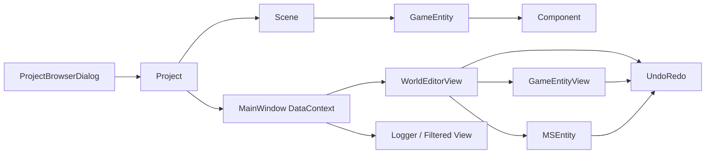
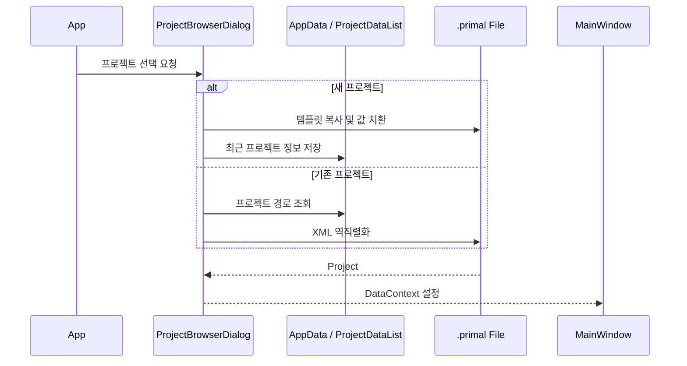
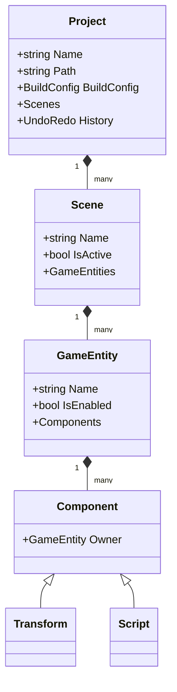
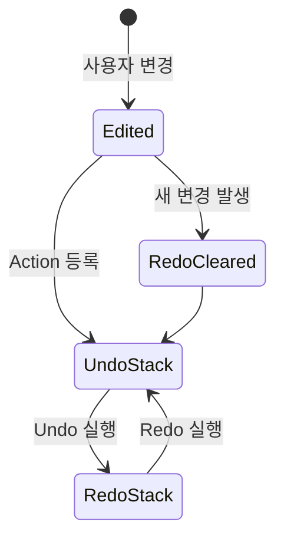
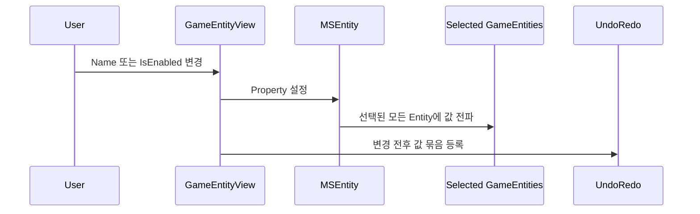
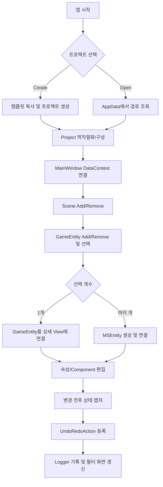

# 문서 목적

이 문서는 Primal Editor 개발 기록 004~008을 다시 읽고, 개별 기능 구현을 하나의 편집기 아키텍처 관점에서 재구성한 기술 문서다. 원본 기록은 그대로 유지하며, 프로젝트 생성·로드부터 Scene 및 GameEntity 편집, Undo/Redo, 다중 선택 편집, Logger까지 이어지는 전체 흐름과 설계 의도를 설명한다.

> [!note] 🧭
> 핵심 주제
> Primal Editor의 편집 상태를 WPF UI와 데이터 모델에 연결하고, 모든 변경을 되돌릴 수 있는 일관된 편집 워크플로로 만드는 과정

# 1. 전체 구조

Primal Editor는 크게 프로젝트 영속화 계층, 편집 모델 계층, WPF 표현 계층, 편집 이력 및 진단 계층으로 나뉜다.

| 계층 | 주요 구성 요소 | 역할 |
| --- | --- | --- |
| 프로젝트 영속화 | `ProjectBrowserDialog`, `ProjectDataList`, XML 직렬화 | 프로젝트 생성·검색·로드, 최근 프로젝트 관리 |
| 편집 모델 | `Project`, `Scene`, `GameEntity`, `Component` | 편집 대상 데이터와 포함 관계 표현 |
| WPF 표현 | `MainWindow`, `WorldEditorView`, `GameEntityView` | DataContext와 Command를 통한 조회·수정 |
| 편집 이력 | `UndoRedo`, `UndoRedoAction` | 변경 전후 상태를 저장하고 Undo/Redo 실행 |
| 다중 선택 | `MSEntity` | 선택된 여러 GameEntity를 하나의 편집 대상으로 추상화 |
| 진단 | Logger, 필터 UI | 스레드 안전 로그 수집 및 메시지 필터링 |



# 2. 프로젝트 생성과 로드

## 2.1 시작 흐름

애플리케이션 시작 시 `ProjectBrowserDialog`를 열어 새 프로젝트를 만들거나 기존 프로젝트를 선택한다. 선택 결과로 얻은 `Project` 객체는 `MainWindow.DataContext`에 연결되며 이후 모든 편집 화면의 루트 상태가 된다.



## 2.2 프로젝트 디렉터리

```plain text
{ProjectPath}/
├── {ProjectName}.primal
├── {ProjectName}.sln
├── .Primal/
│   ├── Icon.png
│   ├── Screenshot.png
│   └── Temp/
├── Content/
├── GameCode/
│   ├── {ProjectName}.vcxproj
│   └── Scripts.cpp
└── x64/
    ├── DebugEditor/{ProjectName}.dll
    └── ReleaseEditor/{ProjectName}.dll
```

- `.primal`: 프로젝트, Scene, GameEntity, Component 구조를 XML로 직렬화한 편집 데이터
- `.Primal`: 아이콘, 스크린샷, 임시 파일 등 편집기 전용 메타데이터
- `Content`: Mesh, Texture, Material 등 에셋
- `GameCode`: 게임 코드와 C++ 프로젝트
- `x64`: Editor용 게임 코드 DLL 빌드 결과

## 2.3 직렬화 모델

`DataContract`와 `DataMember`를 사용해 객체 그래프를 저장한다. 객체 간 참조는 `IsReference = true`를 통해 참조 ID로 직렬화한다. `Component`는 기반 클래스이므로 역직렬화 시 실제 타입을 알 수 있도록 `KnownType`에 `Transform` 등 파생 타입을 등록해야 한다.

| 객체 | 저장 정보 |
| --- | --- |
| Project | 이름, 경로, 빌드 설정, Scene 목록 |
| Scene | 이름, 활성 상태, GameEntity 목록, Project 참조 |
| GameEntity | 이름, 활성 상태, 부모 Scene, Component 목록 |
| Transform | Position, Rotation, Scale |
| Script | 스크립트 타입 이름 |

Script의 런타임 Entity ID와 `AvailableScripts`는 저장 데이터가 아니라 DLL 로드 후 다시 구성되는 런타임 상태다.

# 3. Scene과 GameEntity 편집 모델

## 3.1 Scene 관리

`WorldEditorView`는 현재 프로젝트의 Scene을 표시하고 Add/Remove 기능을 제공한다. UI의 Command는 프로젝트 모델을 변경한 뒤 동일한 작업을 되돌릴 수 있도록 Undo/Redo 이력도 함께 등록한다.

## 3.2 GameEntity와 Component

`GameEntity`는 이름과 활성 상태를 가지며 여러 Component를 소유한다. 각 Component는 자신이 속한 GameEntity를 참조한다. `Transform`, `Camera`, `Light`, `Script` 등은 공통 `Component`를 상속해 확장된다.



## 3.3 선택과 상세 편집

`ProjectLayoutView` 또는 Entity 목록에서 선택한 GameEntity를 `GameEntityView.DataContext`에 전달한다. 상세 화면은 바인딩된 객체의 `Name`, `IsEnabled`, Component 값을 표시하고 수정한다.

> [!tip] 💡
> DataContext는 단순한 화면 데이터 전달 수단이 아니라 편집 대상의 경계를 정의한다. 단일 선택에서는 GameEntity, 다중 선택에서는 MSEntity를 DataContext로 사용한다.

# 4. Undo/Redo 시스템

## 4.1 기본 구조

`UndoRedoAction`은 Undo와 Redo에 사용할 두 개의 동작을 보관한다. `UndoRedo`는 Undo 스택과 Redo 스택을 관리한다.

1. 사용자 입력으로 모델을 변경한다.
2. 변경 전 값과 변경 후 값을 캡처한다.
3. Undo/Redo 콜백을 `UndoRedoAction`으로 등록한다.
4. Undo 실행 시 Undo 스택의 Action을 수행하고 Redo 스택으로 이동한다.
5. Redo 실행 시 Redo 스택의 Action을 수행하고 Undo 스택으로 이동한다.



## 4.2 값 기반 편집

GameEntity의 `IsEnabled` 변경이나 Rename은 old value와 new value를 캡처해 처리한다. TextBox의 Enter는 변경 확정, Esc는 취소라는 공통 동작으로 정의하고 `ResourceDictionary`의 `ControlTemplate`/Style을 통해 재사용한다.

## 4.3 Collection 및 Selection 변경

Scene 또는 GameEntity의 Add/Remove는 객체뿐 아니라 원래 인덱스도 함께 보존해야 정확히 복원할 수 있다. Selection 변경은 추가 선택 목록과 해제 선택 목록을 캐시한 뒤 Undo/Redo 시 반대로 적용한다.

## 4.4 재진입 방지

Undo/Redo 콜백이 모델이나 선택 상태를 다시 변경하면 `PropertyChanged` 또는 `SelectionChanged`가 재발생할 수 있다. 이때 새로운 이력이 등록되면 스택이 오염되거나 무한 호출이 발생한다.

따라서 다음 원칙이 필요하다.

- Undo/Redo 실행 중임을 나타내는 상태 플래그를 둔다.
- 이 플래그가 활성화된 동안 새 Action 등록을 막는다.
- 모델 값을 복원한 뒤 ViewModel을 `Refresh`한다.
- `Refresh` 중에는 일반 편집용 `PropertyChanged` 처리 경로를 비활성화한다.

# 5. 다중 선택 편집: MSEntity

## 5.1 목적

여러 GameEntity를 선택한 상태에서 `Name`, `IsEnabled`, 공통 Component 값을 한 번에 바꾸기 위해 선택 집합을 대표하는 `MSEntity`를 사용한다. Entity 목록의 Selection이 바뀔 때마다 현재 선택 목록으로 MSEntity를 생성하고 `GameEntityView.DataContext`에 연결한다.

## 5.2 값 전파



MSEntity의 `PropertyChanged` 처리기는 선택된 모든 Entity에 동일한 값을 설정한다. 단, 서로 다른 초기값을 가진 속성은 UI에서 혼합 상태를 표현할 수 있어야 하며, 사용자가 값을 명시적으로 확정한 경우에만 전체에 전파하는 것이 안전하다.

## 5.3 다중 선택 Undo/Redo

개별 Entity마다 독립 Action을 등록하면 한 번의 사용자 조작이 여러 Undo 단계로 분리된다. 따라서 UI 입력 이벤트를 트랜잭션 경계로 삼아 하나의 복합 Action을 등록한다.

6. 변경 전 각 Entity의 값을 배열로 캐시한다.
7. 새 값을 선택된 모든 Entity에 적용한다.
8. Undo는 캐시된 개별 값을 복원한다.
9. Redo는 새 값을 다시 전체 적용한다.
10. 복원 후 `MSEntity.Refresh()`로 화면을 동기화한다.
11. Refresh 중 `_enableUpdates`를 비활성화해 값 전파의 재진입을 막는다.

> [!warning] ⚠️
> 다중 선택 편집의 Undo 단위는 “Entity 하나의 변경”이 아니라 “사용자 입력 한 번”이어야 한다. 이 경계를 지키지 않으면 일부 Entity만 복원되거나 Undo 횟수가 선택 개수만큼 증가한다.

# 6. Logger와 필터링

Logger는 UI 스레드와 작업 스레드 양쪽에서 메시지를 받을 수 있으므로 컬렉션 갱신을 스레드 안전하게 처리해야 한다. 화면에서는 메시지 유형별 필터 버튼을 제공하고, 현재 필터 조건에 맞는 항목만 표시한다.

권장 처리 흐름:

12. 모든 로그를 원본 컬렉션에 기록한다.
13. UI 갱신이 필요하면 Dispatcher를 통해 UI 스레드로 전달한다.
14. 화면은 원본을 직접 삭제하지 않고 CollectionView의 Filter를 사용한다.
15. 필터 상태가 바뀌면 View를 Refresh한다.

이 구조를 사용하면 로그 원본은 유지하면서 화면 표현만 전환할 수 있다.

# 7. WPF 공통 UI 인프라

- 공통 Style과 `ControlTemplate`은 별도 `ResourceDictionary`에 정의한다.
- 기존 Application Resource를 유지하면서 추가하려면 `MergedDictionaries`를 사용한다.
- TextBox의 Enter/Esc 동작처럼 여러 화면에서 반복되는 상호작용은 공통 Style 또는 Behavior로 묶는다.
- View는 입력과 표현에 집중하고, 모델 변경과 이력 등록은 Command 또는 명시적인 이벤트 처리 경계에서 수행한다.

# 8. 전체 편집 흐름



# 9. 구현 시 핵심 불변 조건

16. 화면에 보이는 객체와 실제 프로젝트 모델은 항상 같은 상태를 가리켜야 한다.
17. 사용자 조작 한 번은 Undo 단계 하나로 기록해야 한다.
18. 새 편집이 발생하면 기존 Redo 이력은 제거해야 한다.
19. Undo/Redo가 발생시킨 이벤트는 새 이력을 만들면 안 된다.
20. 다중 선택 Undo는 모든 대상의 원래 값을 각각 복원해야 한다.
21. 역직렬화 후 런타임 전용 상태와 부모 참조를 재구성해야 한다.
22. Logger의 원본 데이터와 화면 필터 상태를 분리해야 한다.

# 10. 검증 체크리스트

- [ ] 새 프로젝트 생성 후 기본 Scene이 정상 로드되는가?
- [ ] 최근 프로젝트 목록에서 기존 프로젝트를 다시 열 수 있는가?
- [ ] Scene 및 GameEntity Add/Remove가 저장 후 복원되는가?
- [ ] Rename과 IsEnabled 변경이 각각 한 번의 Undo로 복원되는가?
- [ ] Selection Undo/Redo 중 새 이력이 등록되지 않는가?
- [ ] 다중 선택 변경이 모든 Entity에 적용되는가?
- [ ] 다중 선택 Undo 시 서로 달랐던 초기값이 각각 복원되는가?
- [ ] Undo/Redo 후 Inspector가 최신 상태로 Refresh되는가?
- [ ] 다른 스레드에서 기록한 로그가 UI 오류 없이 표시되는가?
- [ ] 로그 필터 변경 시 원본 로그가 손실되지 않는가?

# 원본 개발 기록

[[004 Open-Create Project]]

[[005 - Add-Remove Scene, Undo-Redo System]]

[[006 - Add GameEntity on Scene, Component class추가]]
